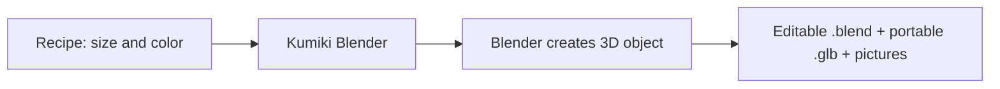

# Start here: your first five minutes

[← Home](https://github.com/YukiUmetsu/kumiki-blender/wiki) · [Next: install the toolkit](https://github.com/YukiUmetsu/kumiki-blender/wiki/Install-on-macOS)

## What is 3D modeling?

Imagine a small toy airplane on your desk. You can walk around it and see its front, wings and back. A **3D model** is a digital version of an object that has height, width and depth. A picture of an airplane is flat; a model can be viewed from any direction.

Blender is a free application for creating, editing, lighting, animating and rendering these objects. [Download Blender from the official website](https://www.blender.org/download/).

Kumiki Blender is **code that tells Blender how to create models**. Instead of manually placing hundreds of bolts, for example, a program can generate their geometry consistently.

## Three things you will work with

1. A **recipe** (usually a `.json` file): the instructions, such as a tower's height and color.
2. **Blender**: the 3D workspace that constructs the object and renders pictures of it.
3. An **export**: the finished model (`.glb`), an editable Blender project (`.blend`), and preview images (`.png`).

You do **not** need to understand this diagram yet. You will run an existing recipe, open the result, and then change two values.

## What this project can and cannot do

- **Can:** generate predefined towers, buildings, aircraft, terrain and study models; export GLB files; create multi-view preview pictures; organize assets into a catalog.
- **Can with more work:** import properly licensed models, apply textures, compare renders with references, and use photo reconstruction tools when photographs overlap sufficiently.
- **Cannot automatically do:** turn one random internet photograph into a perfectly accurate statue, guarantee realistic faces, or turn every reference into a finished cinematic asset with one click.

## Your first tiny goal

You will create a red steel observation tower, rotate the camera around it and make a taller or shorter version. You are *not* expected to build a human face, sculpt, rig, or write Python.

## What is a terminal?

A **terminal** is a window where you type or paste commands. It is how this toolkit is used.

- **Mac:** open **Terminal** using Spotlight Search.
- **Windows:** open **PowerShell** from the Start menu.
- **Linux:** open your terminal application.

A command is not a sentence. Copy it exactly, including the dashes and spaces. Press **Enter** to run it. If the terminal prints an error, see [Troubleshooting](https://github.com/YukiUmetsu/kumiki-blender/wiki/Troubleshooting).

Commands in the guide assume you are inside the `kumiki-blender` folder. The command `cd` means **change directory** (move into a folder). You do not need to know more terminal commands to begin.

**Ready?** Choose the setup guide for [macOS](https://github.com/YukiUmetsu/kumiki-blender/wiki/Install-on-macOS), [Windows](https://github.com/YukiUmetsu/kumiki-blender/wiki/Install-on-Windows), or [Linux](https://github.com/YukiUmetsu/kumiki-blender/wiki/Install-on-Linux).
