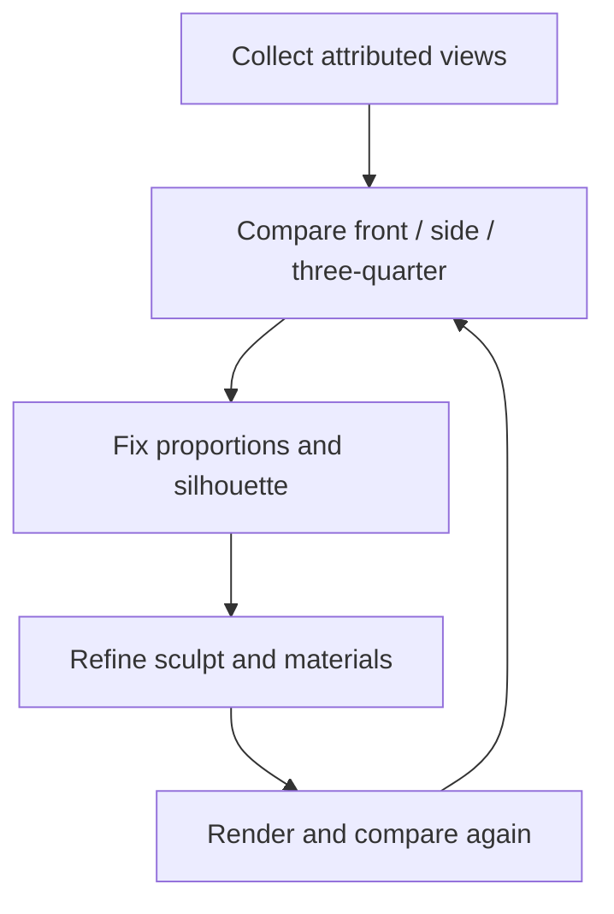

# Use reference images to make better models

[← Home](https://github.com/YukiUmetsu/kumiki-blender/wiki)

Want to make the Statue of Liberty, the Great Sphinx, a mountain, or a historical building? **Good reference photographs matter more than adding random detail.** A model can contain thousands of polygons and still have the wrong silhouette.

## What is a reference image?

A reference is a photograph, drawing, measured plan or 3D scan that tells you what the real object looks like. It helps with **proportions** (relative sizes), **silhouette** (outline), materials, damage, carvings, and details from different viewpoints.

You can start with photos and compare them beside Blender renders. However, this repo does not currently have a beginner-friendly command that turns any arbitrary web photograph into a finished accurate 3D sculpture.

## Collect useful views

For a statue or complex object, look for:

1. A clear **front** view, useful for left/right proportion and face width.
2. A **side** view, vital for depth, nose, chin and body profile.
3. A **three-quarter** view, which connects front and side shapes.
4. A **back** view when available, for drapery, hair, wings, supports or unseen geometry.
5. **Close-ups** of surfaces and distinctive details, plus any available measured drawings or surveys.

For a building, include each elevation, roof view, doors and windows. For mountains, look for height data (a **digital elevation model**) and photographs from named viewpoints.

**Do not mix photos of different replicas** or treat an artistic illustration as measured ground truth. Lens perspective and camera positions can make an object appear distorted.

## A beginner-friendly reference workflow

1. Pick **one** real object and collect a small folder of source-labeled images.
2. Identify the unique details that make it recognizable.
3. Compare a **neutral gray** 3D render from the front and side against matching reference viewpoints.
4. Fix the big shapes first: height, width, facial/head profile or overall building outline.
5. Only after the shape matches, improve materials, weathering, cracks, seams, ornaments and close-up detail.
6. Repeat from multiple views, then inspect the exported GLB as well as the Blender render.

## Can I use photos or 3D scans found online?

You can study legitimately accessible references, but **viewing an image is not the same as having permission to redistribute a downloaded scan or derived raw geometry**. Record the source URL, creator, license and any attribution requirements. Keep restricted reference assets out of the repository. Do not claim that an unverified model is an authentic survey.

The repository's `import-asset` workflow explicitly requires a provenance declaration for a local GLB. That declaration is your statement of rights; software cannot verify the license for you.

## Advanced tools you may grow into

These are **not required for the first tower**:

- [Reference reconstruction](https://github.com/YukiUmetsu/kumiki-blender/blob/main/docs/REFERENCE_RECONSTRUCTION.md): audits a photo collection and checks whether it has enough viewpoints. Optional COLMAP/pycolmap photogrammetry requires sufficiently overlapping photographs.
- [Dense statue reconstruction](https://github.com/YukiUmetsu/kumiki-blender/blob/main/docs/DENSE_STATUE_RECONSTRUCTION.md): reconstructs candidate geometry from registered photos; it is not a guaranteed one-click model or facial likeness.
- [Anatomical head bases](https://github.com/YukiUmetsu/kumiki-blender/blob/main/docs/ANATOMICAL_HEAD_BASES.md): align a reviewed human head mesh to a monument's facial landmarks, then inspect/sculpt it.
- [Material packs](https://github.com/YukiUmetsu/kumiki-blender/blob/main/docs/MATERIAL_PACKS.md): apply licensed color, roughness and normal images to appropriate surfaces.

**Realism is a visual judgment, not a status flag.** A technically valid GLB can still look wrong. Use reference images and honest, multi-view review.
